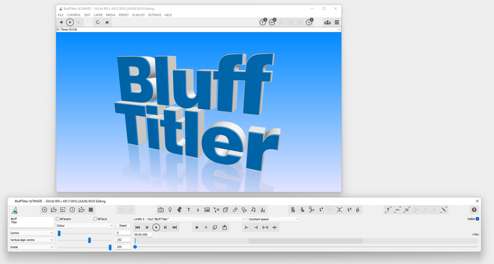
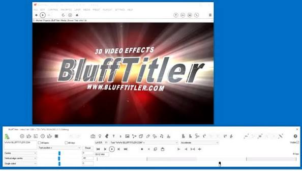
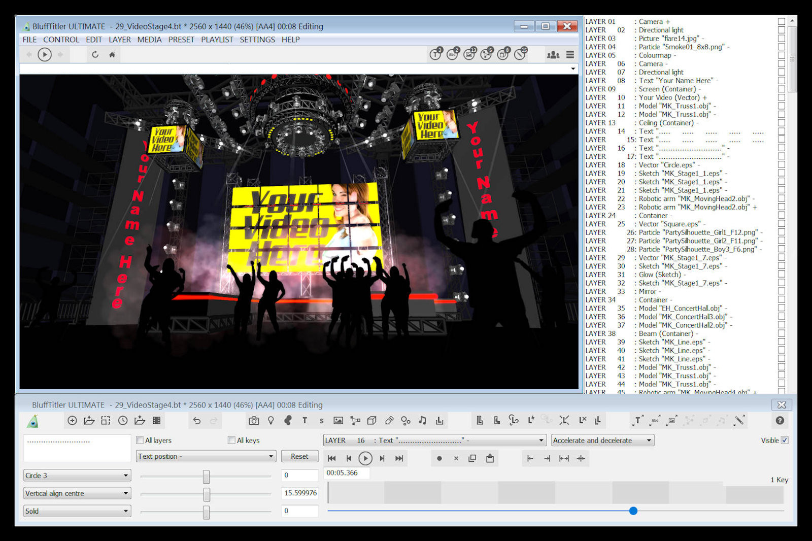

# BluffTitler 3D Title Animation Workflow Guide

BluffTitler is a Windows application for designing
animated 3D titles, intros, logos, effects, and presentation graphics.

Its real-time workflow lets creators manipulate layers,
keyframes, cameras, lighting, textures, and effects
while viewing the rendered composition.

This independent repository explains practical production concepts
for BluffTitler software and related motion-design workflows.

It is not an official Outerspace Software repository
and does not contain the proprietary BluffTitler source code.

## Features

BluffTitler focuses on approachable real-time 3D animation.

Core capabilities include:

- Extruded and beveled 3D text
- Keyframe-based property animation
- Camera and lighting layers
- Texture and shader effects
- Particle, plasma, picture, video, and model layers
- Editable shows, presets, and BixPack assets
- MP4, AVI, GLB, JPG, and PNG output
- Alpha-channel output for supported formats

The application is designed for Windows
and uses GPU rendering for interactive previews.

[](https://blufftitler-software.github.io/blufftitler-effects/)

## Repository Scope

The local source snapshot belongs to Natron,
an independent open-source compositing application.

It is included only as an architectural reference
for rendering, graphics compatibility,
plug-in hosting, and media-processing concepts.

The main reference project organization is declared in
[Project.pro](Project.pro).

Its alternative CMake configuration is available in
[CMakeLists.txt](CMakeLists.txt),
while reusable dependency rules appear in
[libs.pri](libs.pri).

None of these files implements BluffTitler effects,
templates, licensing, or project formats.

## Show Structure

A BluffTitler composition is called a show.

A show combines layers whose properties change over time.
Each layer can contribute visual content,
lighting, camera behavior, audio, or scene organization.

| Layer category | Typical purpose | Example use |
|---|---|---|
| Text | Three-dimensional typography | Titles and lower thirds |
| Camera | Scene view and projection | Orbit or zoom animation |
| Light | Illumination and shading | Highlights and moving beams |
| Picture | Raster artwork or texture | Logos and backgrounds |
| Model | Imported 3D geometry | Product or symbol animation |
| Particle | Repeated animated elements | Sparks, stars, or trails |
| Audio | Soundtrack and timing | Music-driven presentation |
| Container | Grouped layer hierarchy | Reusable scene sections |

A clear layer naming scheme makes complex shows
easier to edit and reuse.



## Text and Typography

Text layers are central to BluffTitler 3D text animation.

A title can combine font glyphs,
depth, beveling, outlines, textures,
lighting, and animated transformations.

Plan typography around the final viewing size.
Fine bevels and thin strokes may disappear
after video compression or downscaling.

Review these properties together:

- Font family and supported glyphs
- Alignment and line spacing
- Extrusion depth
- Bevel profile
- Character spacing
- Surface material
- Lighting response
- Animation timing

Use licensed fonts with clear redistribution terms
when delivering editable projects or templates.

## Keyframes and Timing

Keyframes store property values at specific moments.

Animation is created by changing values
such as position, rotation, size,
color, transparency, or effect parameters.

For readable title animation:

1. Reserve time for the entrance.
2. Hold the title long enough to read.
3. Keep important motion inside safe areas.
4. Add a deliberate exit.
5. Preview the complete loop before export.

Avoid animating every available property.
A few coordinated movements usually communicate
more clearly than many unrelated effects.

## Camera and Lighting

Every show needs a camera layer
to define how the scene is viewed.

Camera movement can create depth
without moving every title or model individually.

Perspective projection emphasizes distance,
while parallel projection produces
a flatter graphic appearance.

Lighting influences bevel visibility,
surface shape, reflections, and scene mood.



Test the composition against both bright
and dark output backgrounds,
especially when transparency will be used.

The related Natron snapshot centralizes
graphics includes in
[GLIncludes.h](Global/GLIncludes.h).

Its platform-wide definitions appear in
[GlobalDefines.h](Global/GlobalDefines.h),
and numerical helper logic appears in
[MathUtils.h](Global/MathUtils.h).

These files are architectural references,
not BluffTitler shader definitions.

## Textures and Effects

BluffTitler effects control how a layer is rendered.

The texture-and-effect dialog can associate
an effect with several texture slots.

Depending on the selected effect,
textures may represent color,
reflection, normal, displacement,
gradient, or cube-map data.

Useful preparation rules include:

- Use seamless images for repeating surfaces
- Match texture resolution to output size
- Preserve alpha channels where needed
- Avoid oversized assets that waste GPU memory
- Test animated textures at the delivery frame rate

BluffTitler effects are compiled shader effects.
Their available properties depend on
the selected layer and effect.

The reference snapshot handles OpenGL loading through
[glad_source.c](Global/glad_source.c).

Compatibility helpers for its Qt-based interface are defined in
[QtCompat.h](Global/QtCompat.h).

## Templates and Community Assets

BluffTitler templates provide editable shows
with prepared layers, effects, and animation.

A useful template should expose
the text, images, colors, and timing
that another creator is expected to change.

Before using BluffTitler templates:

- Confirm the required BluffTitler version
- Check whether external fonts are needed
- Verify texture and media licenses
- Inspect missing-file warnings
- Save a separate working copy
- Test the final resolution and aspect ratio

The BluffTitler community contains shared ideas,
shows, techniques, and downloadable assets.

Third-party templates should be scanned
and reviewed before production use.

## BixPack Workflow

BixPacks extend the available collection
of shows, templates, textures, and media.

Treat every pack as a dependency.
Archive its name and version with the project
when long-term reproducibility matters.

A small project manifest can document dependencies.
This JSON is a handoff example,
not a native BluffTitler configuration file:

```json
{
  "project": "Product Intro",
  "resolution": "1920x1080",
  "frameRate": 30,
  "templatePack": "Record pack name and version",
  "fonts": ["Record required font names"]
}
```

## Real-Time Performance

Interactive performance depends on
the graphics card, driver,
output resolution, texture sizes,
and complexity of the active show.

Current requirements include
64-bit Windows and a DirectX 11-capable GPU.

Use Windows Diagnostic Tool to record
graphics and DirectX information:

```powershell
dxdiag /t "$env:TEMP\blufftitler-dxdiag.txt"
Get-Content "$env:TEMP\blufftitler-dxdiag.txt" |
  Select-String "Card name|Driver Version|Feature Levels"
```

These are Windows system commands,
not BluffTitler commands.

The related compositor inspects process information in
[ProcInfo.cpp](Global/ProcInfo.cpp).

Its cross-platform string and path utilities appear in
[StrUtils.cpp](Global/StrUtils.cpp),
while Python environment support is implemented in
[PythonUtils.cpp](Global/PythonUtils.cpp).

## Export Options

Choose an output format based on
how the animation will be delivered.

| Output | Suitable use | Main consideration |
|---|---|---|
| MP4 | Final playback and online delivery | Compact, normally no alpha |
| AVI | Intermediate editing file | Can produce very large files |
| PNG sequence | Compositing and transparency | Many individual files |
| JPG sequence | Image-based delivery | No alpha channel |
| GLB | Animated 3D model exchange | Validate materials and animation |
| GIF | Short web animation | Limited color and compression |

Set show resolution before exporting.
Then verify frame rate, format,
quality mode, transparency,
and the final-frame option.

## Transparent Output

Transparent titles are useful
when BluffTitler output will be placed
over footage in another video editor.

The selected format must support an alpha channel.
PNG sequences are a dependable choice
for preserving per-frame transparency.

After export, count the numbered frames:

```powershell
Get-ChildItem ".\TitleSequence" -Filter "*.png" |
  Sort-Object Name |
  Measure-Object
```

This PowerShell example validates a directory.
It is not a BluffTitler automation interface.



Inspect several frames in software
that displays transparency correctly.
A black preview background does not necessarily mean
that alpha information is missing.

## MP4 and External Encoding

MP4 is suitable when the animation
is already the final deliverable.

The Windows encoder produces H.264/AAC output
where supported by the operating system.

BluffTitler can also work with
a separately configured FFmpeg executable
for additional export formats.

The following FFprobe command inspects an exported file.
It belongs to the FFmpeg toolset,
not BluffTitler:

```powershell
ffprobe -v error -show_entries stream=codec_name,width,height,pix_fmt `
  -show_entries format=duration,format_name `
  -of json ".\title-output.mp4"
```

Use it to verify codec,
dimensions, pixel format, container,
and reported duration.

## Reference Architecture

The Natron snapshot includes
host-library rules in
[HostSupport.pro](HostSupport/HostSupport.pro)
and parallel CMake definitions in
[HostSupport/CMakeLists.txt](HostSupport/CMakeLists.txt).

Its precompiled host header
[pch.h](HostSupport/pch.h)
collects OpenFX interfaces.

Keyboard symbol mappings are maintained in
[KeySymbols.h](Global/KeySymbols.h).

Build-time plug-in branch selections appear in
[plugin-branches.sh](Global/plugin-branches.sh).

Source revision metadata is recorded by
[GitVersion.h](Global/GitVersion.h).

Linux packaging information is represented by
[Natron.spec](Natron.spec).

These references show how a graphics application
can separate platform, plug-in,
rendering, input, and packaging responsibilities.

They do not document BluffTitler internals.

## Production Checklist

Before delivering an animation:

- Confirm spelling and punctuation
- Verify font and template licenses
- Check safe margins
- Preview every camera transition
- Inspect reflections and texture seams
- Confirm the intended frame rate
- Test transparency where required
- Check output duration
- Play the result on the target device
- Keep the editable show and original assets

Archive source images, models,
fonts, audio, and dependency notes
with the final approved export.


## Related Search Terms
blufftitler software, blufftitler effects, blufftitler community, blufftitler templates, blufftitler 3D text animation, 3d-animation, motion-graphics, title-animation, text-animation, video-effects, directx, shaders, templates, video-export, windows, rendering
